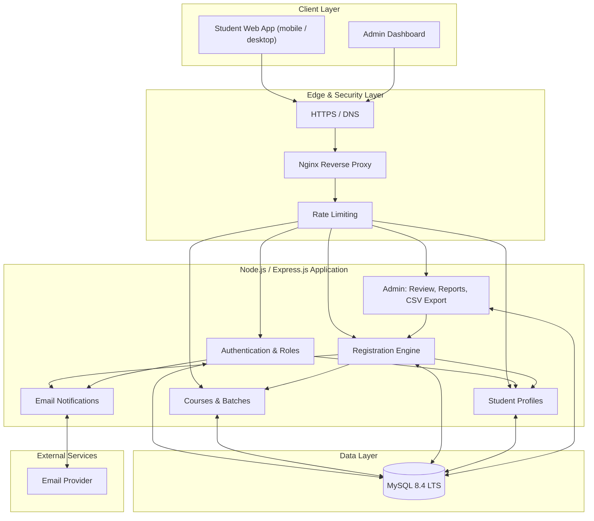
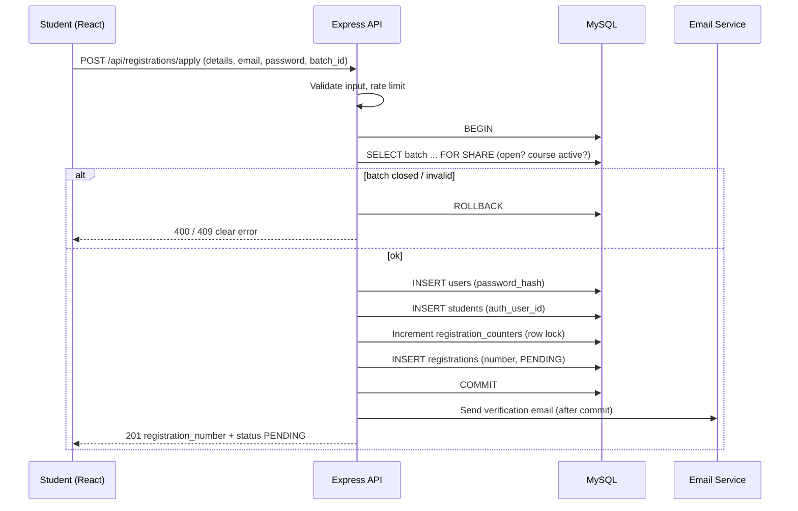

# LLC Student Registration System: Architecture Design

## 1. Architectural Overview
The system is a **3-tier application delivered as a Modular Monolith**: a React single-page frontend, a Node.js/Express REST API organized into feature modules, and a **MySQL 8.4** relational database. One deployable backend keeps hosting simple while internal module boundaries (auth, courses, batches, registrations, admin) stay clean enough to split later if ever needed.

## 2. Technology Stack
*   **Backend**: Node.js (JavaScript only)
*   **API Framework**: Express.js
*   **Frontend**: React (Vite), React Router
*   **Database**: MySQL 8.4 LTS (InnoDB, utf8mb4)
*   **DB Driver**: `mysql2` (connection pool, promises) with parameterized queries
*   **API Communication**: REST API (JSON)
*   **Authentication**: Email/password; bcrypt/argon2 hashing; JWT in HTTP-only cookies
*   **Validation**: Server-side schema validation (e.g., Joi/Zod-style validators written in JavaScript)
*   **Email**: Transactional email service (verification, password reset)
*   **Security middleware**: Helmet, CORS allow-list, `express-rate-limit`
*   **Hosting Strategy**: Single VPS (Nginx + Node via PM2) with managed or self-hosted MySQL; always online, independent of any developer machine

## 3. High-Level Component Diagram

## 4. Core Application Modules
1.  **Authentication & Role Management**: Registration of credentials, login/logout, email verification, password recovery, JWT cookie issuance, and role-based access control (`student`, `admin`).
2.  **Student Profiles**: Stores and returns the profile linked 1:1 to a user (`students.auth_user_id`).
3.  **Courses & Batches**: Public catalog of active courses and open batches; admin create/edit/activate/deactivate and open/close registration.
4.  **Registration Engine**: The core transactional workflow. Rechecks batch availability, creates user + profile + registration in one transaction, generates the unique registration number, sets status `PENDING`, and rolls back on any error.
5.  **Registration Review (Admin)**: Search, filter, view details, update status (with history), and enforce valid status values.
6.  **Reports & CSV Export**: Dashboard statistics (totals per status, per course/batch) and CSV export of permitted fields.
7.  **Notifications**: Verification and password-reset emails; optional "status changed" email. Sent after the DB commit so email failures never roll back a registration.
8.  **Audit & Security**: Audit logs for status changes and course/batch edits; rate limiting; input validation.

## 5. Replacing Supabase Auth and RLS with a MySQL Stack

The SRD was written around Supabase (PostgreSQL, Auth, RLS). MySQL has neither, so each capability maps to an explicit equivalent:

| SRD / Supabase concept | MySQL-stack replacement |
|---|---|
| Supabase Auth user + `auth_user_id` | `users` table (email, `password_hash`, role); `students.auth_user_id` references `users.id` |
| Password handling by Supabase | bcrypt/argon2 hash in Node; raw passwords never stored or logged |
| Email confirmation | `email_verification_tokens` (hashed token, expiry, single use) |
| Account recovery | `password_reset_tokens` (hashed token, short expiry, single use) |
| Row Level Security policies | Server-side authorization: `requireAuth`, `requireRole('admin')`, and ownership-scoped queries (`WHERE student_id = :currentStudentId`) |
| Publishable key in browser | Not needed; browser only talks to the Express API. DB credentials never leave the server |
| Service-role key | DB credentials in server environment variables only |
| Postgres function/transaction for related writes | MySQL transaction in `registration.service.js` (`BEGIN ... COMMIT / ROLLBACK`) or a stored procedure |
| `CHECK` / enum status | MySQL `ENUM` or `CHECK` constraint (MySQL 8.0.16+ enforces `CHECK`) |
| UUID primary keys (`gen_random_uuid`) | `CHAR(36)` with `DEFAULT (UUID())` |

Because the browser never connects to the database directly, there is no "exposed table" surface; all access flows through the API, where authentication and authorization are enforced on every request.

## 6. Registration Flow

## 7. Security & Reliability Controls

### Security
*   **Transport**: HTTPS only (Nginx + TLS certificate); HSTS via Helmet.
*   **Auth**: Short-lived JWT in HTTP-only, Secure, SameSite cookie; identity verified on the server for every protected route.
*   **Authorization**: Role middleware plus ownership checks in services; hiding UI elements is never relied upon.
*   **Data Protection**: Parameterized queries only; least-privilege MySQL user; secrets in environment variables.
*   **Abuse Protection**: Rate limits on `/auth/*` and `/registrations/apply`; generic auth error messages.
*   **Auditability**: `audit_logs` and `registration_status_history` record who changed what and when.

### Reliability
*   **Data Consistency**: Transactions, foreign keys, `UNIQUE` constraints (registration number, student+batch).
*   **No False Success**: API returns success only after `COMMIT`.
*   **Backups**: Automated daily MySQL backups (`mysqldump` or provider snapshots) with a documented, tested restore procedure.
*   **Monitoring**: PM2 process management and log monitoring.

## 8. Scaling Path
1.  **Phase 1 (Current)**: One VPS running Nginx, Node.js (PM2/Docker), and MySQL.
2.  **Phase 2**: Move MySQL to a managed database service for backups and failover.
3.  **Phase 3**: Add read replica or Redis cache for the public course catalog if traffic grows.
4.  **Phase 4**: Extract email/export workloads into background workers if required.
