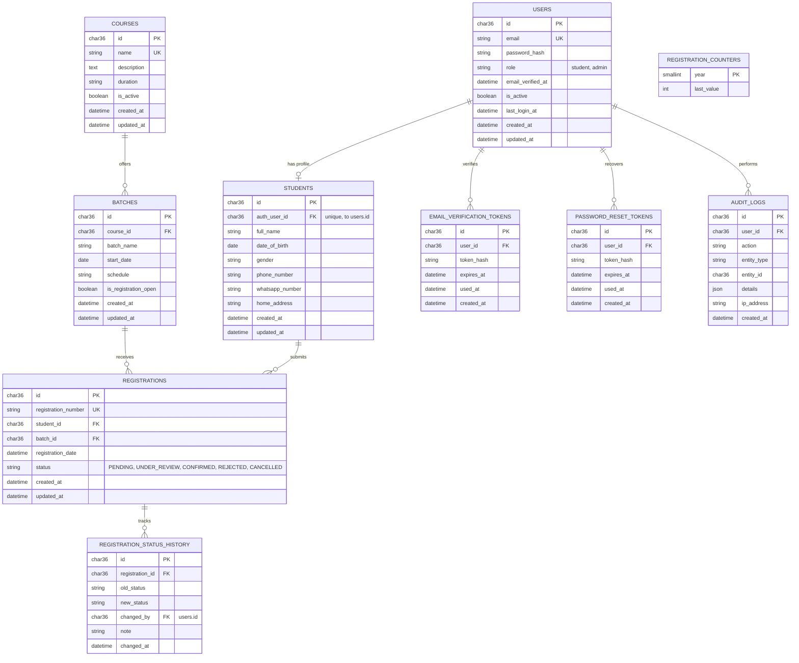

# LLC Student Registration System: Database Design

## 1. Overview
The database uses **MySQL 8.4 LTS (InnoDB, `utf8mb4`)** as its relational store. The schema enforces integrity through primary/foreign keys, `UNIQUE` constraints, `CHECK`/`ENUM` status values, and transactions, so a registration is either fully created or not created at all.

Conventions:
- Primary and foreign keys are UUIDs stored as `CHAR(36)` with `DEFAULT (UUID())`.
- Timestamps are server-generated (`DEFAULT CURRENT_TIMESTAMP`, `ON UPDATE CURRENT_TIMESTAMP`).
- Passwords exist only as a salted hash in `users.password_hash`.

## 2. Entity Relationship Diagram (ERD)



## 3. Core Tables and Attributes

### 3.1. Identity & Access
*   **`users`**: Login identity (replaces Supabase Auth). *Columns*: `id`, `email` (unique), `password_hash`, `role` (`student`, `admin`), `email_verified_at`, `is_active`, `last_login_at`, timestamps.
*   **`email_verification_tokens`** / **`password_reset_tokens`**: Store only a **hash** of the token, `expires_at`, and `used_at` (single use).

### 3.2. Students
*   **`students`**: Profile details. *Columns*: `id`, `auth_user_id` (unique FK to `users.id`), `full_name`, `date_of_birth` (nullable), `gender` (nullable), `phone_number`, `whatsapp_number` (nullable), `home_address` (nullable), timestamps.

### 3.3. Catalog
*   **`courses`**: `id`, `name`, `description`, `duration`, `is_active`, timestamps.
*   **`batches`**: `id`, `course_id`, `batch_name`, `start_date`, `schedule`, `is_registration_open`, timestamps.

### 3.4. Registrations (The Core Engine)
*   **`registrations`**: `id`, `registration_number` (unique), `student_id`, `batch_id`, `registration_date`, `status`, timestamps. Unique on (`student_id`, `batch_id`).
*   **`registration_counters`**: One row per year; used inside the registration transaction to generate sequential numbers such as `LLC-2026-000001`.
*   **`registration_status_history`**: Immutable log of every status change.

### 3.5. Audit
*   **`audit_logs`**: Records admin actions (status updates, course/batch changes, exports).

## 4. SQL Schema (MySQL 8.4)

```sql
CREATE DATABASE IF NOT EXISTS llc_registration
  CHARACTER SET utf8mb4 COLLATE utf8mb4_0900_ai_ci;
USE llc_registration;

CREATE TABLE users (
  id               CHAR(36)     NOT NULL DEFAULT (UUID()),
  email            VARCHAR(255) NOT NULL,
  password_hash    VARCHAR(255) NOT NULL,
  role             ENUM('student','admin') NOT NULL DEFAULT 'student',
  email_verified_at DATETIME    NULL,
  is_active        BOOLEAN      NOT NULL DEFAULT TRUE,
  last_login_at    DATETIME     NULL,
  created_at       DATETIME     NOT NULL DEFAULT CURRENT_TIMESTAMP,
  updated_at       DATETIME     NOT NULL DEFAULT CURRENT_TIMESTAMP ON UPDATE CURRENT_TIMESTAMP,
  PRIMARY KEY (id),
  UNIQUE KEY uq_users_email (email)
) ENGINE=InnoDB;

CREATE TABLE students (
  id               CHAR(36)     NOT NULL DEFAULT (UUID()),
  auth_user_id     CHAR(36)     NOT NULL,
  full_name        VARCHAR(150) NOT NULL,
  date_of_birth    DATE         NULL,
  gender           VARCHAR(20)  NULL,
  phone_number     VARCHAR(30)  NOT NULL,
  whatsapp_number  VARCHAR(30)  NULL,
  home_address     VARCHAR(255) NULL,
  created_at       DATETIME     NOT NULL DEFAULT CURRENT_TIMESTAMP,
  updated_at       DATETIME     NOT NULL DEFAULT CURRENT_TIMESTAMP ON UPDATE CURRENT_TIMESTAMP,
  PRIMARY KEY (id),
  UNIQUE KEY uq_students_auth_user (auth_user_id),
  KEY idx_students_phone (phone_number),
  KEY idx_students_name (full_name),
  CONSTRAINT fk_students_user FOREIGN KEY (auth_user_id)
    REFERENCES users(id) ON DELETE RESTRICT
) ENGINE=InnoDB;

CREATE TABLE courses (
  id           CHAR(36)     NOT NULL DEFAULT (UUID()),
  name         VARCHAR(150) NOT NULL,
  description  TEXT         NULL,
  duration     VARCHAR(60)  NULL,
  is_active    BOOLEAN      NOT NULL DEFAULT TRUE,
  created_at   DATETIME     NOT NULL DEFAULT CURRENT_TIMESTAMP,
  updated_at   DATETIME     NOT NULL DEFAULT CURRENT_TIMESTAMP ON UPDATE CURRENT_TIMESTAMP,
  PRIMARY KEY (id),
  UNIQUE KEY uq_courses_name (name)
) ENGINE=InnoDB;

CREATE TABLE batches (
  id                    CHAR(36)     NOT NULL DEFAULT (UUID()),
  course_id             CHAR(36)     NOT NULL,
  batch_name            VARCHAR(100) NOT NULL,
  start_date            DATE         NOT NULL,
  schedule              VARCHAR(200) NULL,
  is_registration_open  BOOLEAN      NOT NULL DEFAULT TRUE,
  created_at            DATETIME     NOT NULL DEFAULT CURRENT_TIMESTAMP,
  updated_at            DATETIME     NOT NULL DEFAULT CURRENT_TIMESTAMP ON UPDATE CURRENT_TIMESTAMP,
  PRIMARY KEY (id),
  UNIQUE KEY uq_batches_course_name (course_id, batch_name),
  KEY idx_batches_open (is_registration_open, start_date),
  CONSTRAINT fk_batches_course FOREIGN KEY (course_id)
    REFERENCES courses(id) ON DELETE RESTRICT
) ENGINE=InnoDB;

CREATE TABLE registration_counters (
  year        SMALLINT NOT NULL,
  last_value  INT      NOT NULL DEFAULT 0,
  PRIMARY KEY (year)
) ENGINE=InnoDB;

CREATE TABLE registrations (
  id                   CHAR(36)    NOT NULL DEFAULT (UUID()),
  registration_number  VARCHAR(20) NOT NULL,
  student_id           CHAR(36)    NOT NULL,
  batch_id             CHAR(36)    NOT NULL,
  registration_date    DATETIME    NOT NULL DEFAULT CURRENT_TIMESTAMP,
  status               ENUM('PENDING','UNDER_REVIEW','CONFIRMED','REJECTED','CANCELLED')
                       NOT NULL DEFAULT 'PENDING',
  created_at           DATETIME    NOT NULL DEFAULT CURRENT_TIMESTAMP,
  updated_at           DATETIME    NOT NULL DEFAULT CURRENT_TIMESTAMP ON UPDATE CURRENT_TIMESTAMP,
  PRIMARY KEY (id),
  UNIQUE KEY uq_registrations_number (registration_number),
  UNIQUE KEY uq_registrations_student_batch (student_id, batch_id),
  KEY idx_registrations_status (status),
  KEY idx_registrations_date (registration_date),
  KEY idx_registrations_batch (batch_id),
  CONSTRAINT fk_reg_student FOREIGN KEY (student_id) REFERENCES students(id) ON DELETE RESTRICT,
  CONSTRAINT fk_reg_batch   FOREIGN KEY (batch_id)   REFERENCES batches(id)  ON DELETE RESTRICT
) ENGINE=InnoDB;

CREATE TABLE registration_status_history (
  id               CHAR(36)    NOT NULL DEFAULT (UUID()),
  registration_id  CHAR(36)    NOT NULL,
  old_status       VARCHAR(20) NULL,
  new_status       VARCHAR(20) NOT NULL,
  changed_by       CHAR(36)    NULL,
  note             VARCHAR(255) NULL,
  changed_at       DATETIME    NOT NULL DEFAULT CURRENT_TIMESTAMP,
  PRIMARY KEY (id),
  KEY idx_hist_registration (registration_id),
  CONSTRAINT fk_hist_reg  FOREIGN KEY (registration_id) REFERENCES registrations(id) ON DELETE CASCADE,
  CONSTRAINT fk_hist_user FOREIGN KEY (changed_by) REFERENCES users(id) ON DELETE SET NULL
) ENGINE=InnoDB;

CREATE TABLE email_verification_tokens (
  id          CHAR(36)     NOT NULL DEFAULT (UUID()),
  user_id     CHAR(36)     NOT NULL,
  token_hash  CHAR(64)     NOT NULL,
  expires_at  DATETIME     NOT NULL,
  used_at     DATETIME     NULL,
  created_at  DATETIME     NOT NULL DEFAULT CURRENT_TIMESTAMP,
  PRIMARY KEY (id),
  UNIQUE KEY uq_evt_hash (token_hash),
  CONSTRAINT fk_evt_user FOREIGN KEY (user_id) REFERENCES users(id) ON DELETE CASCADE
) ENGINE=InnoDB;

CREATE TABLE password_reset_tokens (
  id          CHAR(36)     NOT NULL DEFAULT (UUID()),
  user_id     CHAR(36)     NOT NULL,
  token_hash  CHAR(64)     NOT NULL,
  expires_at  DATETIME     NOT NULL,
  used_at     DATETIME     NULL,
  created_at  DATETIME     NOT NULL DEFAULT CURRENT_TIMESTAMP,
  PRIMARY KEY (id),
  UNIQUE KEY uq_prt_hash (token_hash),
  CONSTRAINT fk_prt_user FOREIGN KEY (user_id) REFERENCES users(id) ON DELETE CASCADE
) ENGINE=InnoDB;

CREATE TABLE audit_logs (
  id           CHAR(36)     NOT NULL DEFAULT (UUID()),
  user_id      CHAR(36)     NULL,
  action       VARCHAR(80)  NOT NULL,
  entity_type  VARCHAR(50)  NULL,
  entity_id    CHAR(36)     NULL,
  details      JSON         NULL,
  ip_address   VARCHAR(45)  NULL,
  created_at   DATETIME     NOT NULL DEFAULT CURRENT_TIMESTAMP,
  PRIMARY KEY (id),
  KEY idx_audit_user (user_id),
  KEY idx_audit_entity (entity_type, entity_id),
  CONSTRAINT fk_audit_user FOREIGN KEY (user_id) REFERENCES users(id) ON DELETE SET NULL
) ENGINE=InnoDB;
```

## 5. Registration Number Generation

Run inside the same transaction as the registration insert:

```sql
INSERT INTO registration_counters (year, last_value)
VALUES (YEAR(CURDATE()), LAST_INSERT_ID(1))
ON DUPLICATE KEY UPDATE last_value = LAST_INSERT_ID(last_value + 1);

SELECT LAST_INSERT_ID() AS next_value;   -- e.g. 1 -> LLC-2026-000001
```

The application formats it as `LLC-{year}-{value padded to 6 digits}`. The row lock on `registration_counters` serializes concurrent registrations, and the `UNIQUE` index on `registration_number` is a second safety net.

## 6. Key Constraints & Data Integrity

1.  **Atomic Registration**: `users`, `students`, `registrations` (and the counter update) are written in one transaction; any error triggers `ROLLBACK`, so no partial records remain.
2.  **Duplicate Prevention**: `UNIQUE (student_id, batch_id)` blocks repeat registration for the same batch while still allowing different courses/batches.
3.  **Valid Statuses**: `ENUM` guarantees only the five allowed statuses.
4.  **Referential Integrity**: Foreign keys with `ON DELETE RESTRICT` prevent deleting courses, batches, or students that have registrations; use `is_active` / `is_registration_open` to retire records instead.
5.  **Access Separation (replaces RLS)**: Student queries always include `WHERE student_id = <authenticated student>`; admin queries require `role = 'admin'` verified server-side. Use a least-privilege MySQL account for the app (`SELECT, INSERT, UPDATE, DELETE` on this schema only).
6.  **Password Safety**: Only `users.password_hash` holds credential data; token tables store hashes, never raw tokens.

## 7. Seed Data
Seed scripts (`backend/db/seeds/`) create the first administrator from environment variables (`ADMIN_EMAIL`, `ADMIN_PASSWORD`) at deploy time. No credentials are committed to the repository; change the initial password after first login.
